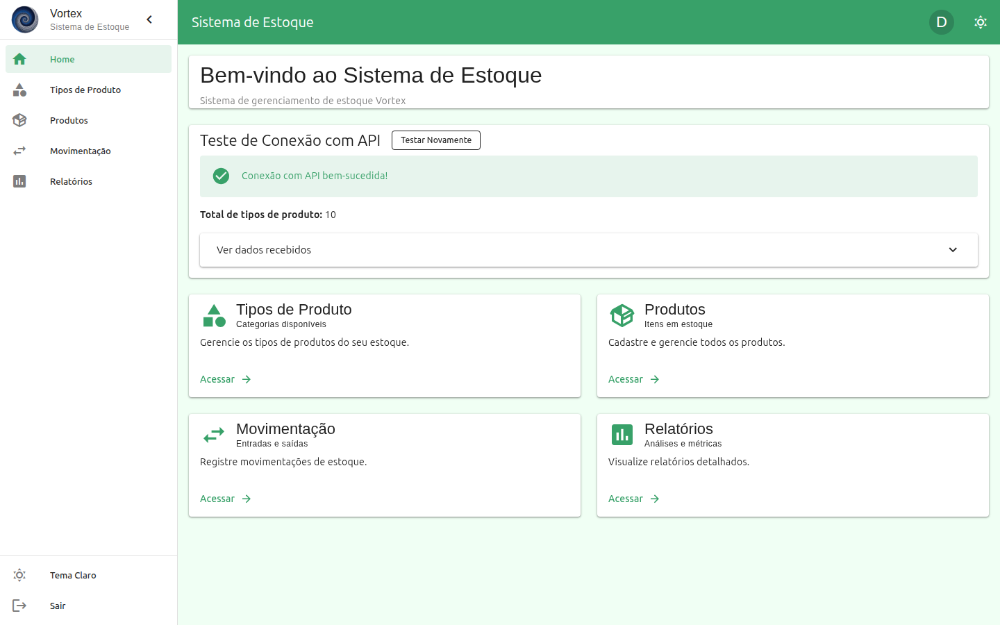
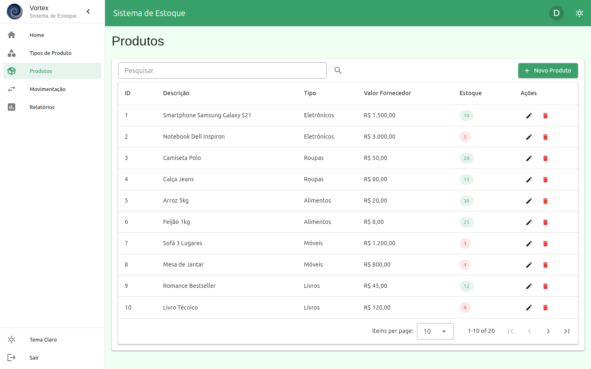
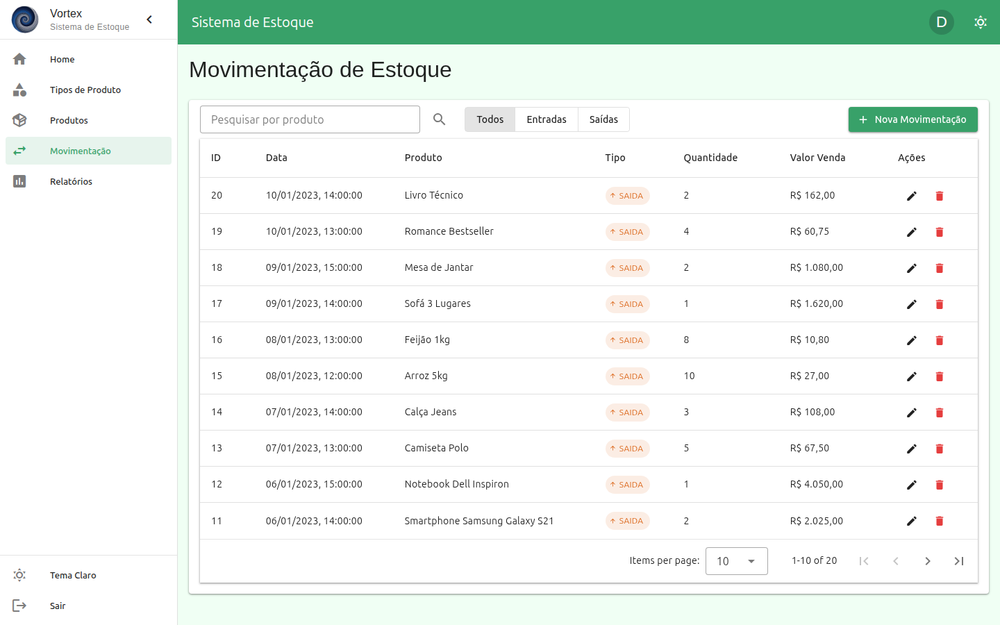
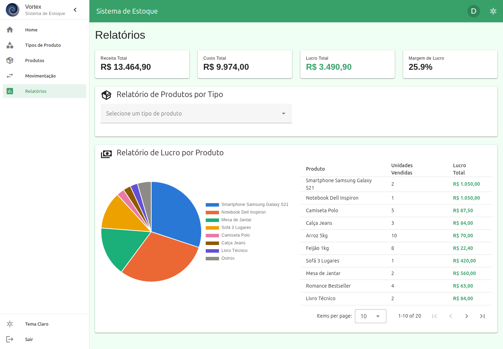
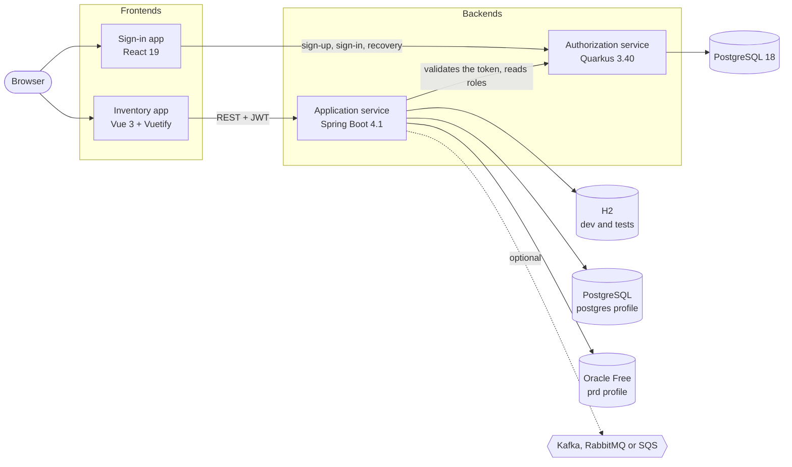

**English** · [Português (Brasil)](README.pt-BR.md)

# Vortex

[](https://github.com/caiocv18/vortex/actions/workflows/app-service.yml)
[](https://github.com/caiocv18/vortex/actions/workflows/auth-service.yml)
[](https://github.com/caiocv18/vortex/actions/workflows/front-app.yml)
[](https://github.com/caiocv18/vortex/actions/workflows/front-auth.yml)
[](https://github.com/caiocv18/vortex/actions/workflows/launcher.yml)
[](https://github.com/caiocv18/vortex/actions/workflows/app-service.yml)

Vortex is an inventory control system built as the capstone project (TCC) of a PUCRS graduate program in full-stack development. It registers product types, products and stock movements in and out, and reports products by type and profit per product. Four services split the work: a Spring Boot API for inventory, a Quarkus service for sign-up and sign-in, and one frontend for each.

The goal of this repository is to show how the system is built and checked, not only what it does: per-service CI, authorization by role with a test that encodes the matrix, database migrations, a hardened cloud profile and the decisions behind them.

**Live demo:** coming soon, on AWS.

## Screenshots

| Dashboard | Products |
|---|---|
|  |  |
| **Stock movements** | **Reports** |
|  |  |

The interface is in Portuguese.

## Architecture



| Service | Path | Port | Stack |
|---|---|---|---|
| Application service | `backend/vortex-application-service` | 8080 | Java 27, Spring Boot 4.1, Spring Security, JPA, Flyway, springdoc |
| Authorization service | `backend/vortex-authorization-service` | 8081 | Java 27, Quarkus 3.40, Hibernate ORM with Panache, Flyway, SmallRye JWT |
| Inventory app | `frontend/vortex-application-service` | 5173 | Vue 3.5, Vuetify 4, Vite 8, TypeScript 6, client generated from OpenAPI |
| Sign-in app | `frontend/vortex-authorization-service` | 3001 | React 19, Tailwind CSS 4, Vite 8, TypeScript 6 |

The application service picks its database by profile:

| Profiles | Database | Used for |
|---|---|---|
| `dev` | H2 in memory, schema by Hibernate | local development |
| `test` (in `src/test/resources`) | H2 in memory, one database per test context | the JUnit suite |
| `dev,postgres` | PostgreSQL, schema by Flyway | a local run on PostgreSQL |
| `cloud,postgres,sqs` | PostgreSQL, schema by Flyway | the public demo, with Swagger, the H2 console and the test endpoints closed |
| `prd` | Oracle Database Free in Docker | the full Docker stack |

## Running it

Requirements: Linux or WSL 2, Java 27 (Temurin), Node.js 26 and Docker Engine with Compose v2.

```bash
git clone https://github.com/caiocv18/vortex.git
cd vortex
./start-vortex.sh --modo leve -e dev -m none --no-interaction
```

This light mode runs both backends as jars with an AOT cache, serves both built frontends from one nginx and keeps the main data on H2, in about 650 MB for the whole system. Open http://localhost:3001 to create an account, then use the inventory app at http://localhost:5173. Stop everything with `./start-vortex.sh --stop`.

Other options: `--modo dev` for hot reload, `-m kafka`, `-m rabbitmq` or `-m sqs` for messaging, and `-e prd` for the Docker stack on Oracle. [README-LAUNCHER.md](README-LAUNCHER.md) (in Portuguese) covers the main options and the memory budget; `./start-vortex.sh --help` lists every flag.

Without the launcher, each line from the repository root, in its own terminal:

```bash
docker compose -f infra/docker/docker-compose.auth.yml up -d auth-db
cd backend/vortex-authorization-service && ./mvnw quarkus:dev
cd frontend/vortex-authorization-service && npm ci && npm run dev
cd backend/vortex-application-service && ./mvnw spring-boot:run -Dspring-boot.run.profiles=dev
cd frontend/vortex-application-service && npm ci && npm run dev
```

The authorization service signs its tokens with an RSA key pair that stays out of git. The launcher creates it; to create it by hand, run the two `openssl` commands in [the service's README](backend/vortex-authorization-service/README.md#chaves-rsa-do-jwt) once, before the first `quarkus:dev`. The `dev` profile keeps the application service on H2 with a local cache, so it needs neither Oracle nor Redis.

## Security

- Sign-up, sign-in, refresh tokens and password recovery live in the authorization service.
- The application service validates every `/api/**` token with the authorization service and authorizes by role: `VIEWER` reads, `USER` and `MANAGER` also write, `ADMIN` also monitors the queues. The full matrix and its decisions are in [docs/security/roles.md](docs/security/roles.md).
- `EndpointAuthorizationCoverageTest` fails when a handler has no rule or disagrees with the matrix, and `RoleAuthorizationIntegrationTest` proves each cell over HTTP.
- The `cloud` profile does not register Swagger, the H2 console or the test endpoints, denies any path outside `/api/**` and `/health`, and refuses to start with the default JWT secret.
- `master` takes changes only through pull requests that pass the five builds and SonarCloud, with signed commits and no bypass, not even for the owner ([ADR 0005](docs/adr/0005-master-ruleset-dependabot-and-immutable-releases.md)).
- CodeQL analyzes the workflows, the Java and the TypeScript. Dependabot opens security fixes as soon as an alert appears, plus grouped monthly version updates that wait seven days after each new release. Its alerts cover the npm lockfiles and the Maven dependencies declared in the poms; the jars that the Spring Boot parent and the Quarkus BOM bring in are flagged by Trivy and move with the parent or BOM update, or get pinned in the pom when the fix cannot wait.
- Every alert is either fixed or dismissed with a written reason, including the accepted risk of keeping tokens in browser storage: [docs/security/alert-triage.md](docs/security/alert-triage.md).
- Releases are immutable and their tags are signed.

## Quality

Each service has its own GitHub Actions workflow, which builds only when that service changes ([ADR 0001](docs/adr/0001-ci-per-service-with-paths-filter.md)). SonarCloud analyzes every pull request.

| Workflow | What it runs |
|---|---|
| `app-service` | `./mvnw -B -ntp verify`: unit and integration tests, PostgreSQL 18 through Testcontainers, JaCoCo gate at 47% of lines |
| `auth-service` | `./mvnw -B -ntp verify`: tests on H2, JaCoCo gates at 60% of lines and 50% of branches |
| `front-app` | ESLint, `vue-tsc` type check, Vitest, production build |
| `front-auth` | ESLint, type check, Vitest, production build |
| `launcher` | ShellCheck, `bash -n` and the executable bit on every script, plus the launcher's own tests |

The coverage badge counts instructions (JaCoCo C0) of the application service, so it differs from the line gate. To run the same checks locally:

```bash
cd backend/vortex-application-service && ./mvnw verify        # needs Docker for Testcontainers
cd backend/vortex-authorization-service && ./mvnw verify
cd frontend/vortex-application-service && npx eslint . && npm run type-check && npx vitest run
cd frontend/vortex-authorization-service && npm run lint && npm run type-check && npx vitest run
```

## Container images

Pushes to `master` publish both backends to the GitHub Container Registry, for `linux/amd64` and `linux/arm64` ([ADR 0004](docs/adr/0004-multi-arch-images-on-ghcr.md)):

| Image | Service | Port |
|---|---|---|
| `ghcr.io/caiocv18/vortex-application-service` | Spring Boot inventory API | 8080 |
| `ghcr.io/caiocv18/vortex-authorization-service` | Quarkus sign-up, sign-in and tokens | 8081 |

`edge` follows `master` and is rebuilt every week to pick up JRE and Alpine fixes, `sha-<commit>` marks each push that gets its own run, and each release adds `X.Y.Z`, `X.Y` and `latest`. Both images run as a non-root user. After each publish, the arm64 application image must answer `/health` on an arm64 runner, and Trivy reports the CRITICAL and HIGH findings that already have a fix, on the arm64 variant of both images, to the repository's Security tab.

The application service runs alone on H2:

```bash
docker run --rm -p 8080:8080 -e SPRING_PROFILES_ACTIVE=dev,leve ghcr.io/caiocv18/vortex-application-service:edge
curl http://localhost:8080/health
```

The authorization service needs PostgreSQL and its JWT key pair. The image carries neither, so each deployment supplies them at runtime.

## Decisions

The [architecture decision records](docs/adr/README.md) explain the choices that shape the code:

1. [One CI workflow per service, gated by a paths filter](docs/adr/0001-ci-per-service-with-paths-filter.md)
2. [An explicit role matrix, without a role hierarchy](docs/adr/0002-explicit-role-matrix-without-hierarchy.md)
3. [PostgreSQL with Flyway for the cloud demo](docs/adr/0003-postgres-with-flyway-for-the-cloud.md)
4. [Multi-arch images on GHCR, built without emulation and scanned by Trivy](docs/adr/0004-multi-arch-images-on-ghcr.md)
5. [A master ruleset without bypass, Dependabot with a cooldown and immutable releases](docs/adr/0005-master-ruleset-dependabot-and-immutable-releases.md)

## Repository layout

```text
backend/
  vortex-application-service/     Spring Boot API: inventory, reports, messaging
  vortex-authorization-service/   Quarkus API: accounts, tokens, roles
frontend/
  vortex-application-service/     Vue inventory app
  vortex-authorization-service/   React sign-in app
infra/                            Docker Compose files, Oracle, Kafka, RabbitMQ, SQS, Terraform
scripts/                          Test, memory and maintenance scripts
docs/
  adr/                            Architecture decision records
  security/                       Role matrix
  application/                    OpenAPI snapshot of the application service
  tcc/                            Capstone documents (Portuguese)
  archive/                        Historical material (Portuguese)
start-vortex.sh                   Launcher
```

## License

[Apache License 2.0](LICENSE).

## Author

[caiocv18](https://github.com/caiocv18) on GitHub.
