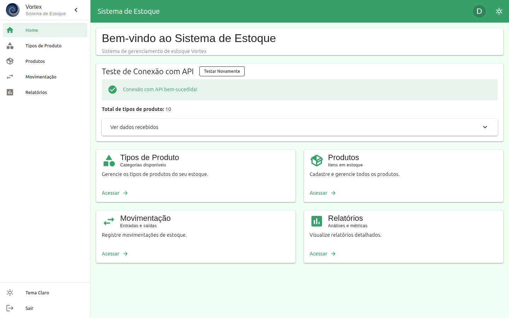
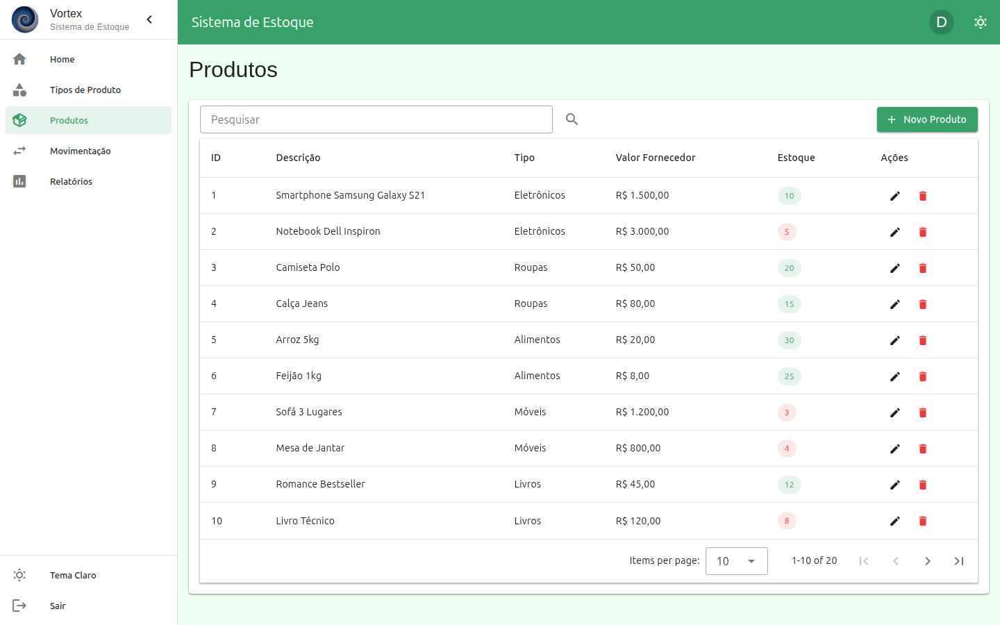
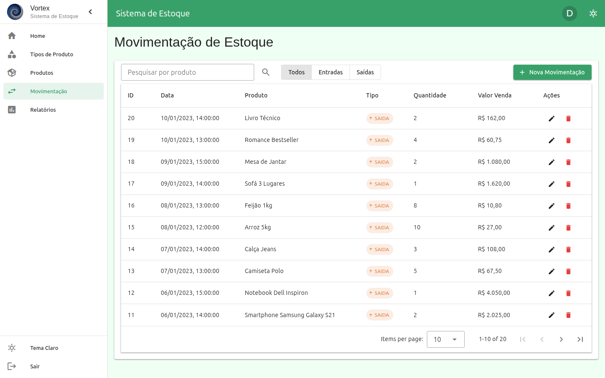
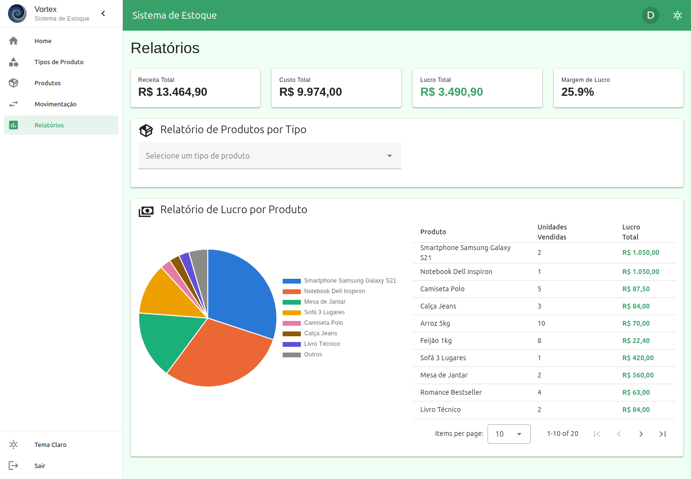
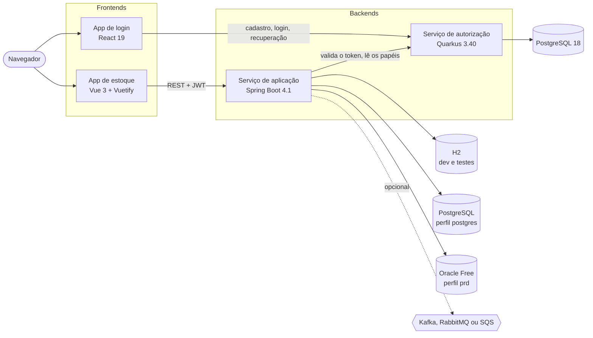

[English](README.md) · **Português (Brasil)**

# Vortex

[](https://github.com/caiocv18/vortex/actions/workflows/app-service.yml)
[](https://github.com/caiocv18/vortex/actions/workflows/auth-service.yml)
[](https://github.com/caiocv18/vortex/actions/workflows/front-app.yml)
[](https://github.com/caiocv18/vortex/actions/workflows/front-auth.yml)
[](https://github.com/caiocv18/vortex/actions/workflows/launcher.yml)
[](https://github.com/caiocv18/vortex/actions/workflows/app-service.yml)

O Vortex é um sistema de controle de estoque construído como TCC de uma pós-graduação da PUCRS em desenvolvimento full-stack. Ele cadastra tipos de produto, produtos e movimentações de entrada e saída, e gera relatórios de produtos por tipo e de lucro por produto. Quatro serviços dividem o trabalho: uma API Spring Boot para o estoque, um serviço Quarkus para cadastro e login, e um frontend para cada um.

O objetivo deste repositório é mostrar como o sistema é construído e verificado, não só o que ele faz: CI por serviço, autorização por papel com um teste que codifica a matriz, migrações de banco, um perfil de nuvem endurecido e as decisões por trás de tudo isso.

**Demo pública:** em breve, na AWS.

## Telas

| Painel | Produtos |
|---|---|
|  |  |
| **Movimentações de estoque** | **Relatórios** |
|  |  |

## Arquitetura



| Serviço | Caminho | Porta | Stack |
|---|---|---|---|
| Serviço de aplicação | `backend/vortex-application-service` | 8080 | Java 27, Spring Boot 4.1, Spring Security, JPA, Flyway, springdoc |
| Serviço de autorização | `backend/vortex-authorization-service` | 8081 | Java 27, Quarkus 3.40, Hibernate ORM com Panache, Flyway, SmallRye JWT |
| App de estoque | `frontend/vortex-application-service` | 5173 | Vue 3.5, Vuetify 4, Vite 8, TypeScript 6, cliente gerado do OpenAPI |
| App de login | `frontend/vortex-authorization-service` | 3001 | React 19, Tailwind CSS 4, Vite 8, TypeScript 6 |

O serviço de aplicação escolhe o banco pelo perfil:

| Perfis | Banco | Uso |
|---|---|---|
| `dev` | H2 em memória, esquema pelo Hibernate | desenvolvimento local |
| `test` (em `src/test/resources`) | H2 em memória, um banco por contexto de teste | a suíte JUnit |
| `dev,postgres` | PostgreSQL, esquema pelo Flyway | execução local em PostgreSQL |
| `cloud,postgres,sqs` | PostgreSQL, esquema pelo Flyway | a demo pública, com Swagger, console do H2 e endpoints de teste fechados |
| `prd` | Oracle Database Free no Docker | a stack Docker completa |

## Como rodar

Requisitos: Linux ou WSL 2, Java 27 (Temurin), Node.js 26 e Docker Engine com Compose v2.

```bash
git clone https://github.com/caiocv18/vortex.git
cd vortex
./start-vortex.sh --modo leve -e dev -m none --no-interaction
```

O modo leve roda os dois backends como jars com cache AOT, serve os dois frontends compilados por um nginx só e mantém os dados principais no H2, em cerca de 650 MB para o sistema inteiro. Abra http://localhost:3001 para criar uma conta e depois use o app de estoque em http://localhost:5173. Para parar tudo, `./start-vortex.sh --stop`.

Outras opções: `--modo dev` para hot reload, `-m kafka`, `-m rabbitmq` ou `-m sqs` para mensageria, e `-e prd` para a stack Docker com Oracle. O [README-LAUNCHER.md](README-LAUNCHER.md) cobre as opções principais e o orçamento de memória; `./start-vortex.sh --help` lista todas.

Sem o launcher, cada linha a partir da raiz do repositório, num terminal próprio:

```bash
docker compose -f infra/docker/docker-compose.auth.yml up -d auth-db
cd backend/vortex-authorization-service && ./mvnw quarkus:dev
cd frontend/vortex-authorization-service && npm ci && npm run dev
cd backend/vortex-application-service && ./mvnw spring-boot:run -Dspring-boot.run.profiles=dev
cd frontend/vortex-application-service && npm ci && npm run dev
```

O serviço de autorização assina os tokens com um par de chaves RSA que fica fora do git. O launcher cria o par; para criar à mão, rode uma vez os dois comandos `openssl` do [README do serviço](backend/vortex-authorization-service/README.md#chaves-rsa-do-jwt), antes do primeiro `quarkus:dev`. O perfil `dev` deixa o serviço de aplicação no H2 com cache local, então ele não precisa de Oracle nem de Redis.

## Segurança

- Cadastro, login, refresh token e recuperação de senha ficam no serviço de autorização.
- O serviço de aplicação valida cada token de `/api/**` no serviço de autorização e autoriza por papel: `VIEWER` lê, `USER` e `MANAGER` também escrevem, `ADMIN` também monitora as filas. A matriz completa e as decisões estão em [docs/security/roles.md](docs/security/roles.md) (em inglês).
- O `EndpointAuthorizationCoverageTest` falha quando um handler não tem regra ou discorda da matriz, e o `RoleAuthorizationIntegrationTest` prova cada célula por HTTP.
- O perfil `cloud` nem registra Swagger, console do H2 e endpoints de teste, nega qualquer caminho fora de `/api/**` e `/health`, e não sobe com o segredo JWT padrão.

## Qualidade

Cada serviço tem o próprio workflow no GitHub Actions, que só compila quando aquele serviço muda ([ADR 0001](docs/adr/0001-ci-per-service-with-paths-filter.md)). O SonarCloud analisa todo pull request.

| Workflow | O que roda |
|---|---|
| `app-service` | `./mvnw -B -ntp verify`: testes unitários e de integração, PostgreSQL 18 pelo Testcontainers, gate do JaCoCo em 47% das linhas |
| `auth-service` | `./mvnw -B -ntp verify`: testes em H2, gates do JaCoCo em 60% das linhas e 50% dos branches |
| `front-app` | ESLint, checagem de tipos com `vue-tsc`, Vitest, build de produção |
| `front-auth` | ESLint, checagem de tipos, Vitest, build de produção |
| `launcher` | ShellCheck, `bash -n` e o bit de execução em todo script, mais os testes do próprio launcher |

O badge de cobertura conta instruções (C0 do JaCoCo) do serviço de aplicação, então difere do gate por linhas. Para rodar as mesmas verificações localmente:

```bash
cd backend/vortex-application-service && ./mvnw verify        # precisa de Docker para o Testcontainers
cd backend/vortex-authorization-service && ./mvnw verify
cd frontend/vortex-application-service && npx eslint . && npm run type-check && npx vitest run
cd frontend/vortex-authorization-service && npm run lint && npm run type-check && npx vitest run
```

## Imagens de contêiner

Os pushes no `master` publicam os dois backends no GitHub Container Registry, para `linux/amd64` e `linux/arm64` ([ADR 0004](docs/adr/0004-multi-arch-images-on-ghcr.md)):

| Imagem | Serviço | Porta |
|---|---|---|
| `ghcr.io/caiocv18/vortex-application-service` | API de estoque em Spring Boot | 8080 |
| `ghcr.io/caiocv18/vortex-authorization-service` | Cadastro, login e tokens em Quarkus | 8081 |

A `edge` acompanha o `master` e é reconstruída toda semana, para trazer as correções da JRE e do Alpine; `sha-<commit>` marca cada push que ganha execução própria, e cada release acrescenta `X.Y.Z`, `X.Y` e `latest`. As duas imagens rodam com um usuário sem privilégios. Depois de cada publicação, a imagem arm64 do serviço de aplicação precisa responder no `/health` num runner arm64, e o Trivy reporta na aba Security do repositório os achados CRITICAL e HIGH que já têm correção, na variante arm64 das duas imagens.

O serviço de aplicação roda sozinho, em H2:

```bash
docker run --rm -p 8080:8080 -e SPRING_PROFILES_ACTIVE=dev,leve ghcr.io/caiocv18/vortex-application-service:edge
curl http://localhost:8080/health
```

O serviço de autorização precisa do PostgreSQL e do par de chaves do JWT. A imagem não leva nenhum dos dois, então cada implantação os fornece em tempo de execução.

## Decisões

Os [registros de decisão de arquitetura](docs/adr/README.md) (em inglês) explicam as escolhas que moldam o código:

1. [Um workflow de CI por serviço, filtrado por caminho](docs/adr/0001-ci-per-service-with-paths-filter.md)
2. [Uma matriz de papéis explícita, sem hierarquia de papéis](docs/adr/0002-explicit-role-matrix-without-hierarchy.md)
3. [PostgreSQL com Flyway para a demo na nuvem](docs/adr/0003-postgres-with-flyway-for-the-cloud.md)
4. [Imagens multiarquitetura no GHCR, construídas sem emulação e analisadas pelo Trivy](docs/adr/0004-multi-arch-images-on-ghcr.md)

## Estrutura do repositório

```text
backend/
  vortex-application-service/     API Spring Boot: estoque, relatórios, mensageria
  vortex-authorization-service/   API Quarkus: contas, tokens, papéis
frontend/
  vortex-application-service/     App de estoque em Vue
  vortex-authorization-service/   App de login em React
infra/                            Arquivos do Docker Compose, Oracle, Kafka, RabbitMQ, SQS, Terraform
scripts/                          Scripts de teste, de memória e de manutenção
docs/
  adr/                            Registros de decisão de arquitetura
  security/                       Matriz de papéis
  application/                    Snapshot do OpenAPI do serviço de aplicação
  tcc/                            Documentos do TCC
  archive/                        Material histórico
start-vortex.sh                   Launcher
```

## Licença

[Apache License 2.0](LICENSE).

## Autor

[caiocv18](https://github.com/caiocv18) no GitHub.
