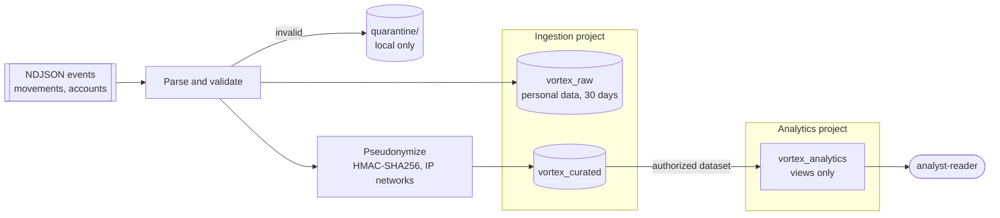

# Data pipeline

An Apache Beam pipeline that turns Vortex events into BigQuery tables on Google Cloud, with personal data pseudonymized before any analyst can see it. The decision and its alternatives are in [ADR 0008](../docs/adr/0008-data-pipeline-on-google-cloud-with-pseudonymization.md); the infrastructure is the `gcp/data` stack in [infra/terraform](../infra/terraform/README.md#google-cloud-data).



## Layout

| Path | What it holds |
|---|---|
| `pipeline/src/vortex_pipeline/parse.py` | One parser per event type: required fields, strict types, UTC timestamps, token ids dropped |
| `pipeline/src/vortex_pipeline/curate.py` | Column and attribute allowlists of the curated tables |
| `pipeline/src/vortex_pipeline/pseudonymize.py` | HMAC pseudonyms and IP networks |
| `pipeline/src/vortex_pipeline/keys.py` | The HMAC key, read from the environment and never printed |
| `pipeline/src/vortex_pipeline/pipeline.py` | The Beam graph: read, parse, curate, write one NDJSON file per table |
| `pipeline/src/vortex_pipeline/bigquery_sandbox.py` | Appends the files to BigQuery and proves who can read what |
| `pipeline/src/vortex_pipeline/rebase.py` | Shifts a sample's date-times by one delta, so its newest event lands now |
| `policy_tags.json` | The raw columns that carry the policy tag, read by Terraform and by `sandbox.sh prove` |
| `pipeline/tests/` | Unit tests and an end-to-end run on the DirectRunner over `tests/fixtures/` |
| `kill-switch/` | The Cloud Run function that unlinks billing from the ingestion project when the budget reports too much spend; its own uv project, deployed by `infra/terraform/gcp/data` (`requirements.txt` is exported from `uv.lock`: `uv export --no-dev --locked --no-header --no-emit-project -o requirements.txt`) |
| `schemas/` | The four table schemas, read by the tests and by Terraform |
| `scripts/` | Key generation, the API sample and the Kafka capture, the local run and the sandbox load and proof |

## Tables

| Table | Dataset | Personal data |
|---|---|---|
| `raw_movements` | `vortex_raw` | the user in `user_id`, the session, the producer's free text |
| `raw_user_events` | `vortex_raw` | username, e-mail, IP address, user agent, session |
| `curated_movements` | `vortex_curated` | none in clear: `user_key` |
| `curated_user_events` | `vortex_curated` | none in clear: `user_key`, `email_key`, `ip_prefix` |

A pseudonym is the HMAC-SHA256 of the trimmed, lowercased value, so `Bob` and `bob ` are the same person and the same `user_key` joins movements with logins. It is still personal data under the LGPD: the key links it back. Every curated row records `hmac_key_version`.

The views of `vortex_analytics` keep the newest copy of each `event_id`, because loads append and a rerun appends the same events again.

## Running it

Requirements: Python 3.12 and [uv](https://docs.astral.sh/uv/) 0.13. From the repository root:

```bash
cd data/pipeline
uv sync --locked
uv run ruff check . && uv run ruff format --check .
uv run pytest
```

The tests need no key and no cloud account, and the floor is 100% of lines and branches. On the first run, the DirectRunner of Beam 2.77 downloads Prism, the Go runner it hands the pipeline to, from the Apache Beam GitHub releases into `~/.apache_beam/cache/prism` (about 25 MB, 87 MB unpacked).

To run the pipeline on the fixtures, create a key once and run it:

```bash
data/scripts/generate-hmac-key.sh    # writes data/.env (mode 600); refuses to replace an existing key
data/scripts/run-local.sh            # writes data/out/<run id>/*.ndjson and quarantine/rejected.ndjson
```

`run-local.sh MOVEMENTS_GLOB USER_EVENTS_GLOB` reads other files; with `--rebase-to-today` first (files, not globs), it shifts every date-time of both by one delta so the newest event lands now, keeping the intervals between events. The inventory API's date-times carry no offset, so they are read in `SOURCE_TIMEZONE` (default `America/Sao_Paulo`). `data/out/` and `data/.env` are git-ignored: the raw files and the quarantine hold personal data.

## Loading into BigQuery

After the `gcp/data` stack is applied and the operator has run `gcloud auth application-default login`:

```bash
data/scripts/sandbox.sh load     # appends the newest data/out run, as pipeline-launcher
data/scripts/sandbox.sh prove    # row counts, v_user_activity read as analyst-reader, base tables and tagged columns refused
```

Both act as a service account through impersonation (the organization forbids service account keys) and read the project ids from the stack's outputs. `prove` exits 1 if the analyst can read a base table, if `v_user_activity` comes back empty, if `pipeline-launcher` can read a column of `policy_tags.json` or is refused for another reason than the policy tag, or if the operator is refused on those columns. The tag needs billing, so in the BigQuery sandbox `prove` fails on it. Every load appends: a truncating load or `CREATE OR REPLACE` would drop the column policy tags.

The partitions expire by event date (30 days in the raw tables, 60 in the curated ones), so a loaded sample leaves the view empty once its events are older than that, and `prove` turns red. Reload it with the dates shifted:

```bash
data/scripts/run-local.sh --rebase-to-today data/landing/<date>/movements.ndjson data/landing/<date>/user_events.ndjson
data/scripts/sandbox.sh load && data/scripts/sandbox.sh prove
```

## A real sample from Kafka

The fixtures are synthetic on purpose (they carry the lines the quarantine must reject). A real sample comes from the two topics the pipeline reads, with fictitious people only:

```bash
./start-vortex.sh --modo leve -e dev -m kafka --no-interaction  # both backends publish to Kafka (about 1 GB)
data/scripts/seed-api.sh        # 3 users <name>-<stamp>@example.com sign up, move stock in and out, sign in again
data/scripts/capture-kafka.sh   # drains vortex.movimento.estoque and vortex-user-events into data/landing/<date>/
```

`capture-kafka.sh` reads from the first offset to the end offset measured when it starts, in a throwaway `apache/kafka:4.4.0` container (the broker image has no CLI tools), and writes nothing if any e-mail outside `example.com` shows up. `data/landing/` is git-ignored: the account events carry e-mail and IP addresses in clear.
