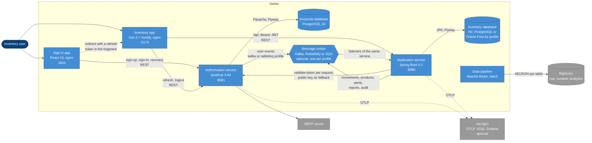

# Containers (C4 level 2)

*[Leia em português](containers.pt-BR.md)*

| Legend | |
|---|---|
| Solid arrow | Synchronous call or write |
| Dotted arrow | Redirect or optional telemetry |
| Hexagon | Broker: only one is active, picked by profile |
| Cylinder | Database |
| Grey | Outside the repository's runtime |

| Container | Path | Notes |
|---|---|---|
| Sign-in app | `frontend/vortex-authorization-service` | Hands the session to the inventory app through the URL fragment |
| Inventory app | `frontend/vortex-application-service` | Client generated from `docs/application/openapi-backend.json`; nginx proxies `/api/` to the application service |
| Application service | `backend/vortex-application-service` | `MessageBrokerService` has one implementation per broker; the database comes from the profile table in the [README](../../README.md#architecture) |
| Authorization service | `backend/vortex-authorization-service` | Issues RSA-signed JWTs; publishes `vortex-user-events` (Kafka) or `vortex.user.events` (RabbitMQ) |
| Data pipeline | `data/pipeline` | Reads NDJSON exports of the events, pseudonymizes, writes one file per table; `bigquery_sandbox` loads them |
| otel-lgtm | `infra/docker/docker-compose.observabilidade.yml` | Traces, metrics and logs with no agent ([ADR 0009](../adr/0009-native-opentelemetry-without-an-agent.md)) |

Kafka topics of the application service (`application-kafka.properties`): `vortex.movimento.estoque`,
`vortex.produto.events`, `vortex.alertas.estoque`, `vortex.relatorios.events` and `vortex.auditoria`.
