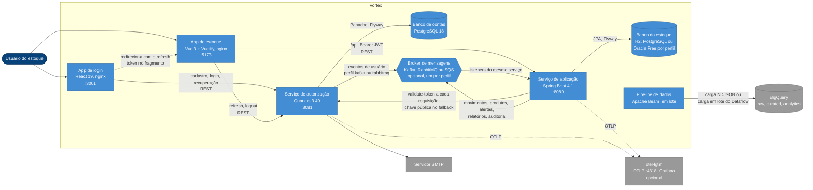

# Containers (C4 nível 2)

*[Read in English](containers.md)*

| Legenda | |
|---|---|
| Seta cheia | Chamada síncrona ou escrita |
| Seta pontilhada | Redirecionamento ou telemetria opcional |
| Hexágono | Broker: só um fica ativo, escolhido pelo perfil |
| Cilindro | Banco de dados |
| Cinza | Fora do runtime do repositório |

| Container | Caminho | Observações |
|---|---|---|
| App de login | `frontend/vortex-authorization-service` | Passa a sessão ao app de estoque pelo fragmento da URL |
| App de estoque | `frontend/vortex-application-service` | Cliente gerado de `docs/application/openapi-backend.json`; o nginx repassa `/api/` ao serviço de aplicação |
| Serviço de aplicação | `backend/vortex-application-service` | `MessageBrokerService` tem uma implementação por broker; o banco sai da tabela de perfis do [README](../../README.pt-BR.md#arquitetura) |
| Serviço de autorização | `backend/vortex-authorization-service` | Emite JWT assinado com RSA; publica `vortex-user-events` (Kafka) ou `vortex.user.events` (RabbitMQ) |
| Pipeline de dados | `data/pipeline` | Lê exportações NDJSON dos eventos, pseudonimiza e grava um arquivo por tabela (execução local; o `bigquery_sandbox` carrega) ou, como job do Dataflow, acrescenta no BigQuery |
| otel-lgtm | `infra/docker/docker-compose.observabilidade.yml` | Traces, métricas e logs sem agente ([ADR 0009](../adr/0009-native-opentelemetry-without-an-agent.md)) |

Tópicos Kafka do serviço de aplicação (`application-kafka.properties`): `vortex.movimento.estoque`,
`vortex.produto.events`, `vortex.alertas.estoque`, `vortex.relatorios.events` e `vortex.auditoria`.
