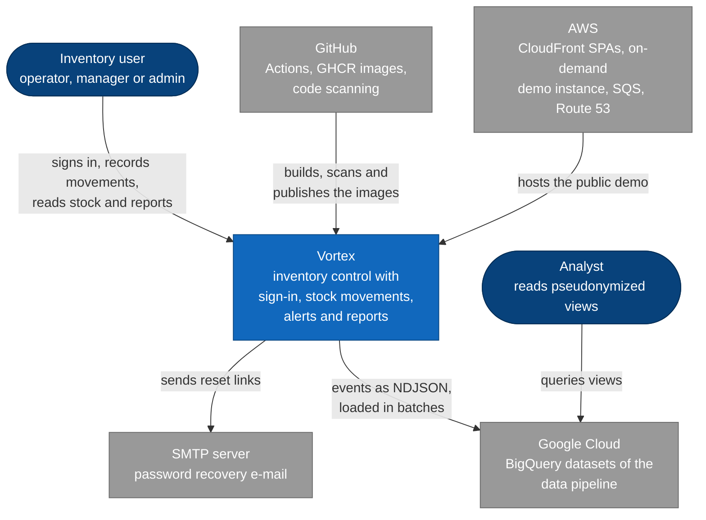

# Context (C4 level 1)

*[Leia em português](context.pt-BR.md)*

| Legend | |
|---|---|
| Dark blue, rounded | Person |
| Blue | The system described here |
| Grey | External system |

- The roles of an inventory user come from an explicit matrix with no hierarchy
  ([ADR 0002](../adr/0002-explicit-role-matrix-without-hierarchy.md)).
- The public demo runs on demand behind Session Manager
  ([ADR 0006](../adr/0006-on-demand-demo-instance-behind-session-manager.md)); the two single-page
  apps are static files on CloudFront ([ADR 0007](../adr/0007-static-spas-on-cloudfront.md)).
- Personal data reaches BigQuery only pseudonymized for analysts
  ([ADR 0008](../adr/0008-data-pipeline-on-google-cloud-with-pseudonymization.md)).
