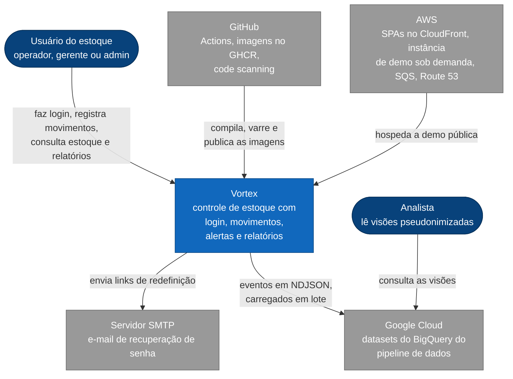

# Contexto (C4 nível 1)

*[Read in English](context.md)*

| Legenda | |
|---|---|
| Azul-escuro, arredondado | Pessoa |
| Azul | O sistema descrito aqui |
| Cinza | Sistema externo |

- Os papéis do usuário do estoque vêm de uma matriz explícita, sem hierarquia
  ([ADR 0002](../adr/0002-explicit-role-matrix-without-hierarchy.md)).
- A demo pública sobe sob demanda, atrás do Session Manager
  ([ADR 0006](../adr/0006-on-demand-demo-instance-behind-session-manager.md)); as duas SPAs são arquivos
  estáticos no CloudFront ([ADR 0007](../adr/0007-static-spas-on-cloudfront.md)).
- Dado pessoal só chega ao analista pseudonimizado
  ([ADR 0008](../adr/0008-data-pipeline-on-google-cloud-with-pseudonymization.md)).
