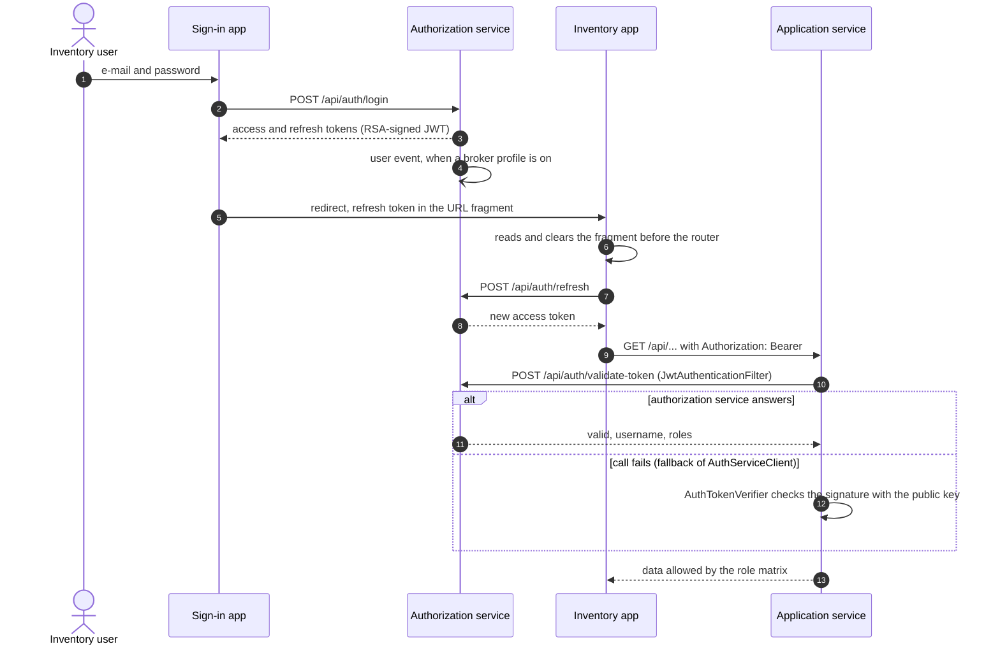
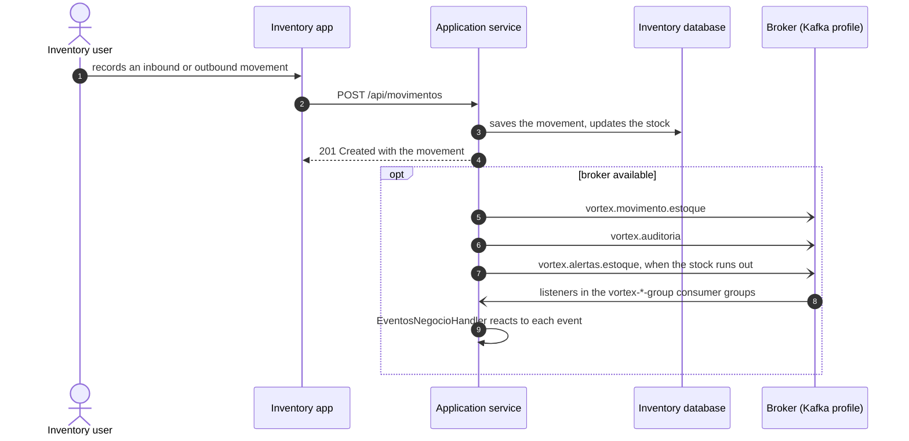

# Runtime flows

*[Leia em português](flows.pt-BR.md)*

## Signing in

## A stock movement

The broker is optional: with none available, `MovimentoEstoqueService` saves the movement and skips the
events. With RabbitMQ or SQS the same events go through the implementation of that broker.
