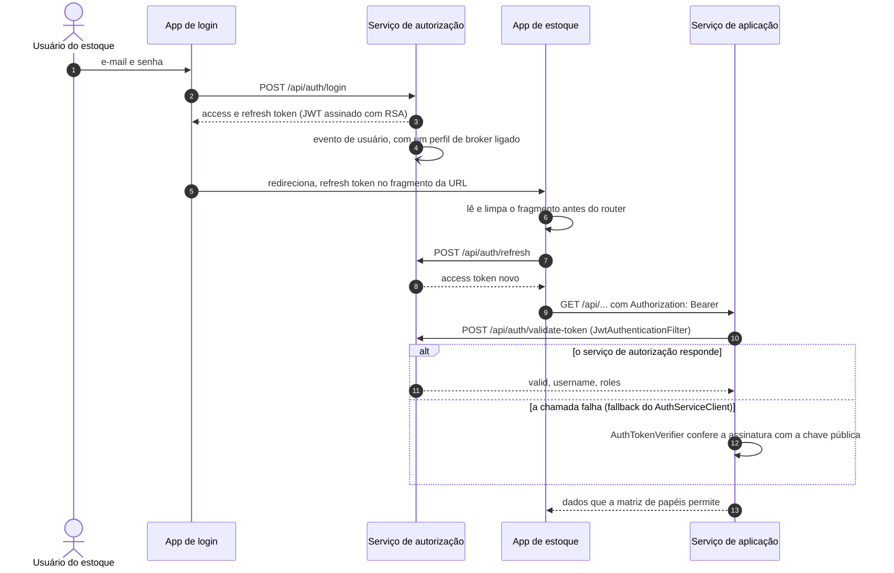
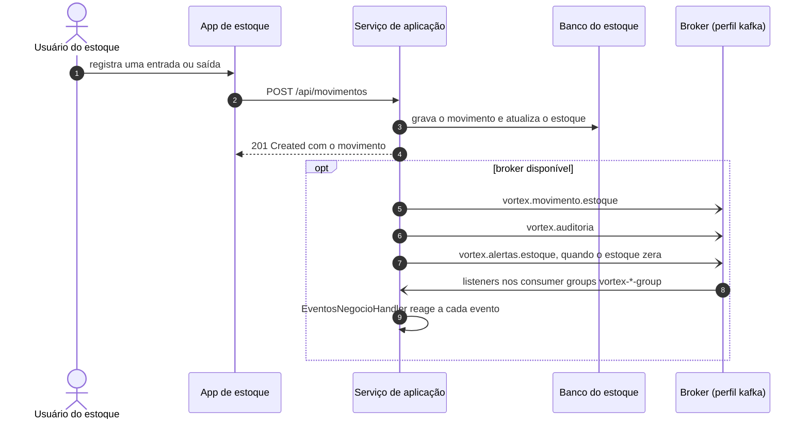

# Fluxos em execução

*[Read in English](flows.md)*

## Login

## Um movimento de estoque

O broker é opcional: sem nenhum disponível, o `MovimentoEstoqueService` grava o movimento e pula os
eventos. Com RabbitMQ ou SQS, os mesmos eventos passam pela implementação daquele broker.
