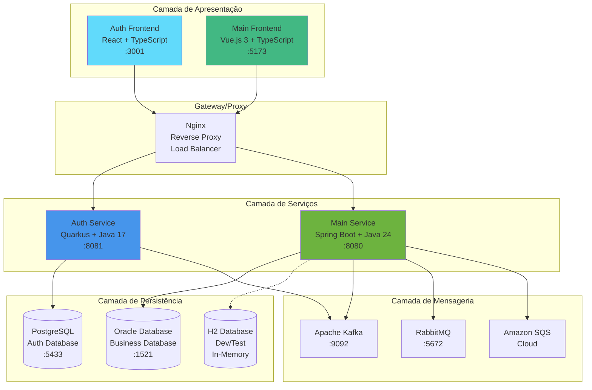
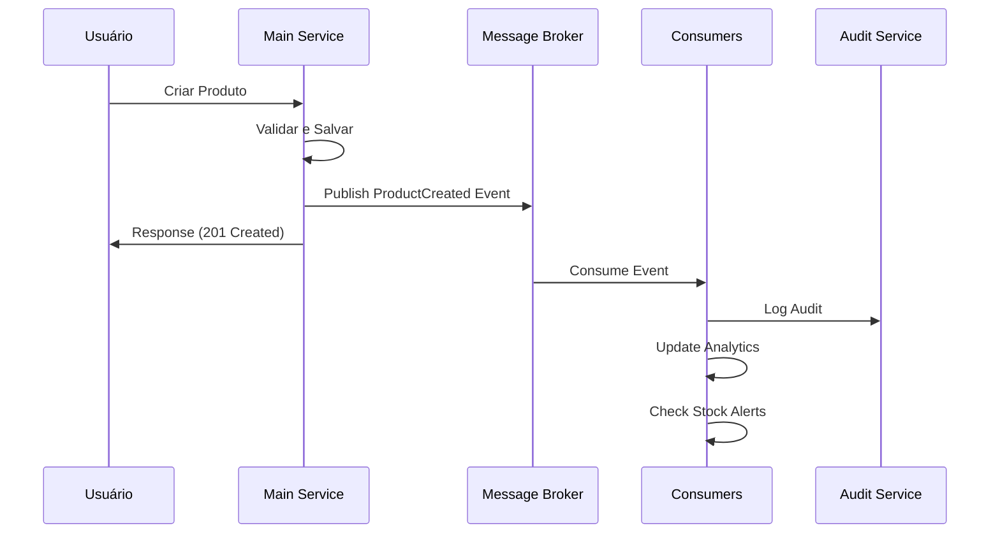
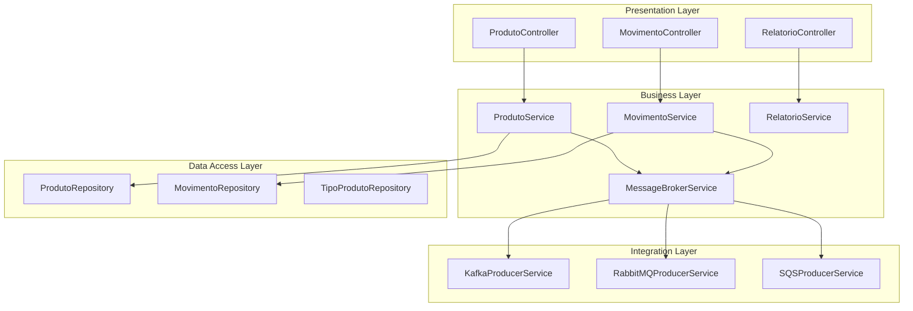
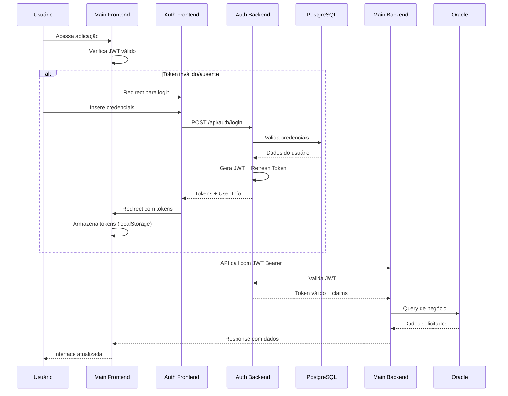
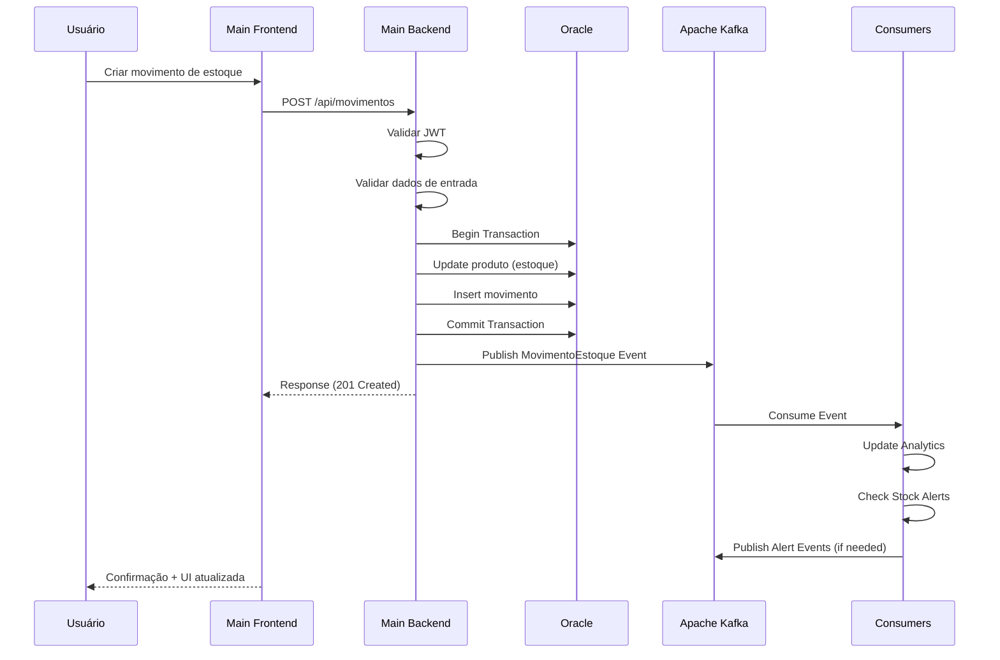
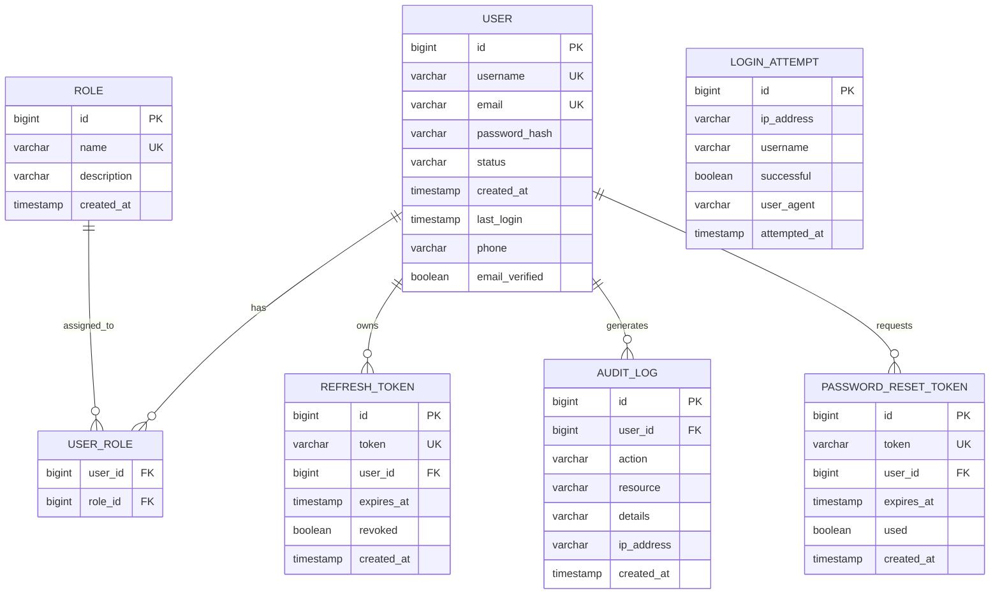
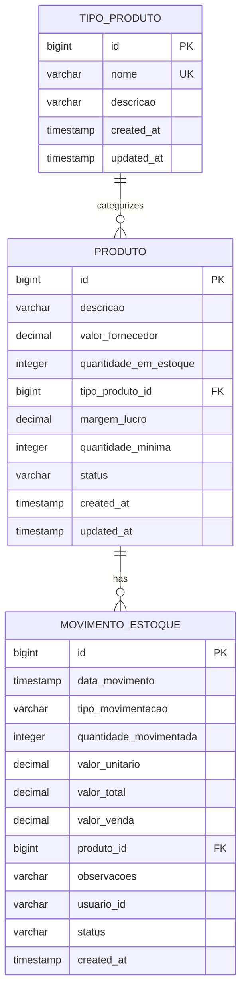
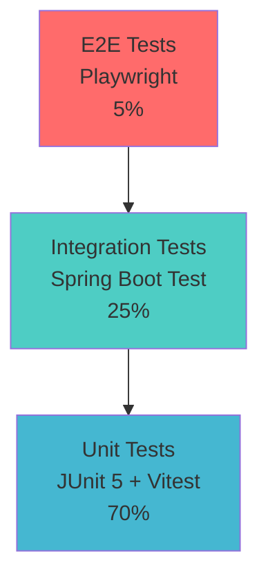

# 7. Arquitetura de Software - Sistema Vortex

## 7.1 Visão Geral da Arquitetura

O Sistema Vortex foi projetado seguindo uma arquitetura de microsserviços moderna, que oferece escalabilidade, manutenibilidade e flexibilidade para o controle de estoque empresarial. A solução implementa uma separação clara de responsabilidades através de quatro microsserviços independentes, cada um com sua própria tecnologia otimizada para seu domínio específico.

### 7.1.1 Decisões Arquiteturais Principais

A arquitetura do Vortex foi fundamentada em cinco decisões estratégicas principais:

**1. Arquitetura de Microsserviços**: Adotada para permitir desenvolvimento e deployment independentes, escalabilidade granular e uso de tecnologias especializadas para cada domínio.

**2. Segregação por Domínio**: Separação clara entre autenticação/autorização e operações de negócio, permitindo especializações tecnológicas distintas.

**3. Comunicação Híbrida**: Combinação de comunicação síncrona (REST APIs) para operações imediatas e assíncrona (message brokers) para eventos e integrações.

**4. Multi-Database**: Cada microsserviço possui seu próprio banco de dados, garantindo independência de dados e otimização específica para cada caso de uso.

**5. Containerização Completa**: Todos os componentes são containerizados, facilitando deployment, escalonamento e portabilidade entre ambientes.

### 7.1.2 Arquitetura de Microsserviços



## 7.2 Componentes do Sistema

### 7.2.1 Microsserviço de Autorização (Authorization Service)

**Tecnologia Core**: Quarkus 3.8.5 + Java 17  
**Padrão Arquitetural**: RESTful Microservice com Reactive Programming  
**Porta**: 8081  
**Responsabilidades**:

- Gerenciamento completo de usuários e credenciais
- Autenticação JWT com tokens de acesso e refresh
- Autorização baseada em roles (ADMIN, USER, MANAGER, VIEWER)
- Rate limiting e proteção contra ataques de força bruta
- Auditoria de eventos de segurança
- Recuperação de senha com tokens temporários

**Estrutura Técnica**:

```java
// Exemplo da estrutura de entidades principais
@Entity
public class User extends PanacheEntity {
    public String username;
    public String email;
    public String passwordHash;
    public UserStatus status;
    public LocalDateTime createdAt;
    public LocalDateTime lastLogin;
    
    @ManyToMany
    public List<Role> roles;
}

@Entity  
public class RefreshToken extends PanacheEntity {
    public String token;
    public LocalDateTime expiresAt;
    public boolean revoked;
    
    @ManyToOne
    public User user;
}
```

**Componentes Principais**:

- **AuthResource**: Endpoints REST para autenticação
- **AuthService**: Lógica de negócio de autenticação
- **JwtService**: Gerenciamento de tokens JWT
- **PasswordService**: Criptografia e validação de senhas
- **RateLimitService**: Controle de taxa de requisições
- **EventPublisher**: Publicação de eventos de auditoria

### 7.2.2 Microsserviço Principal (Main Application Service)

**Tecnologia Core**: Spring Boot 3.5.3 + Java 24  
**Padrão Arquitetural**: Layered Architecture (Controller → Service → Repository)  
**Porta**: 8080  
**Responsabilidades**:

- Gestão completa de produtos e tipos de produtos
- Controle de movimentações de estoque (entradas/saídas)
- Cálculo automático de valores e margens de lucro
- Geração de relatórios gerenciais e análise de dados
- Integração com múltiplos message brokers
- Monitoramento de filas e health checks

**Estrutura em Camadas**:

```java
// Controller Layer
@RestController
@RequestMapping("/api/produtos")
public class ProdutoController {
    @Autowired private ProdutoService produtoService;
    
    @PostMapping
    public ResponseEntity<ProdutoDTO> criarProduto(@RequestBody ProdutoDTO dto) {
        return ResponseEntity.ok(produtoService.criarProduto(dto));
    }
}

// Service Layer  
@Service
@Transactional
public class ProdutoService {
    @Autowired private ProdutoRepository repository;
    @Autowired private MessageBrokerService messageBroker;
    
    public ProdutoDTO criarProduto(ProdutoDTO dto) {
        Produto produto = repository.save(convertToEntity(dto));
        messageBroker.publicarProdutoCriado(produto, getCurrentUserId());
        return convertToDTO(produto);
    }
}

// Repository Layer
public interface ProdutoRepository extends JpaRepository<Produto, Long> {
    List<Produto> findByTipoProdutoId(Long tipoProdutoId);
    List<Produto> findByQuantidadeEmEstoqueLessThan(Integer quantidade);
}
```

**Componentes Principais**:

- **Controllers**: ProdutoController, MovimentoController, RelatorioController
- **Services**: ProdutoService, MovimentoEstoqueService, RelatorioService
- **Repositories**: Camada de acesso a dados com Spring Data JPA
- **MessageBrokerFactory**: Factory pattern para seleção de message brokers
- **SecurityConfig**: Configuração de segurança e integração JWT

### 7.2.3 Frontend Principal (Main Frontend)

**Tecnologia Core**: Vue.js 3 + TypeScript + Vuetify 3  
**Padrão Arquitetural**: Component-Based Architecture + State Management  
**Porta**: 5173 (dev) / 4173 (production)  
**Responsabilidades**:

- Interface de usuário moderna e responsiva
- Gestão de produtos, tipos e movimentações
- Visualização de relatórios com gráficos interativos
- Integração com APIs através de clientes auto-gerados
- Gerenciamento de estado com Pinia
- Guards de autenticação e roteamento inteligente

**Arquitetura de Componentes**:

```typescript
// Store (Pinia) - Estado Global
export const useProductStore = defineStore('products', {
  state: () => ({
    products: [] as Product[],
    loading: false,
    error: null
  }),
  
  actions: {
    async fetchProducts() {
      this.loading = true;
      try {
        this.products = await productApi.getAllProducts();
      } catch (error) {
        this.error = error;
      } finally {
        this.loading = false;
      }
    }
  }
});

// Router Guards - Proteção de Rotas
router.beforeEach(async (to, from, next) => {
  const authStore = useAuthStore();
  
  if (to.meta.requiresAuth && !authStore.isAuthenticated) {
    window.location.href = 'http://localhost:3001/login';
    return;
  }
  
  next();
});
```

### 7.2.4 Frontend de Autenticação (Auth Frontend)

**Tecnologia Core**: React 18 + TypeScript + TailwindCSS  
**Padrão Arquitetural**: SPA com Context-Based State Management  
**Porta**: 3001  
**Responsabilidades**:

- Interface especializada para autenticação
- Formulários de login, registro e recuperação de senha
- Validação client-side com Yup
- Gerenciamento de estado de autenticação
- Redirecionamento inteligente pós-autenticação
- Feedback visual de operações assíncronas

## 7.3 Padrões Arquiteturais Implementados

### 7.3.1 Factory Pattern - Message Broker Selection

O sistema implementa o padrão Factory para abstração e seleção dinâmica de message brokers:

```java
@Configuration
public class MessageBrokerFactory {
    
    @Bean
    @Primary
    public MessageBrokerService messageBrokerService() {
        switch (brokerType.toLowerCase()) {
            case "kafka":
                return createKafkaService();
            case "rabbitmq":
                return createRabbitMQService();
            case "sqs":
                return createSQSService();
            case "none":
                return createNoOpService();
            default:
                return createKafkaService();
        }
    }
}
```

**Vantagens**:
- Abstração da complexidade de configuração
- Flexibilidade para alternar entre diferentes message brokers
- Facilita testes com implementação NoOp
- Configuração dinâmica baseada em propriedades

### 7.3.2 Repository Pattern - Camada de Persistência

Implementação do padrão Repository com Spring Data JPA:

```java
public interface ProdutoRepository extends JpaRepository<Produto, Long> {
    // Query Methods
    List<Produto> findByTipoProdutoId(Long tipoProdutoId);
    List<Produto> findByQuantidadeEmEstoqueLessThan(Integer quantidade);
    
    // Custom Queries  
    @Query("SELECT p FROM Produto p WHERE p.quantidadeEmEstoque = 0")
    List<Produto> findProdutosEsgotados();
    
    // Native Query
    @Query(value = "SELECT * FROM produto WHERE valor_fornecedor > :valor", 
           nativeQuery = true)
    List<Produto> findProdutosAcimaValor(@Param("valor") BigDecimal valor);
}
```

### 7.3.3 Event-Driven Architecture

Sistema de eventos assíncronos para desacoplamento e escalabilidade:



**Tipos de Eventos Implementados**:

- **Eventos de Produto**: Criação, atualização, exclusão
- **Eventos de Movimento**: Entradas e saídas de estoque
- **Eventos de Alerta**: Estoque baixo, esgotado, crítico
- **Eventos de Auditoria**: Registro de todas as operações
- **Eventos de Autenticação**: Login, logout, recuperação de senha

### 7.3.4 Layered Architecture - Separação de Responsabilidades



## 7.4 Fluxos de Comunicação

### 7.4.1 Fluxo de Autenticação JWT

O sistema implementa um fluxo de autenticação robusto e seguro:



**Características de Segurança**:

- **Access Token**: 15 minutos de validade
- **Refresh Token**: 7 dias de validade  
- **Rate Limiting**: 5 tentativas por minuto por IP
- **Token Blacklist**: Invalidação imediata no logout
- **Timing Attack Protection**: Delays consistentes em validações

### 7.4.2 Fluxo de Operações de Negócio



### 7.4.3 Integração entre Microsserviços

A comunicação entre serviços segue padrões bem definidos:

**1. Comunicação Síncrona (REST)**:
- Validação de JWT entre Main Service e Auth Service
- Operações imediatas que requerem resposta
- Health checks e status de serviços

**2. Comunicação Assíncrona (Event-Driven)**:
- Eventos de auditoria e logging
- Notificações de alterações de estoque
- Integração com sistemas externos
- Análise de dados e relatórios

## 7.5 Modelo de Dados

### 7.5.1 Domínio de Autenticação (PostgreSQL)



### 7.5.2 Domínio de Negócio (Oracle/H2)



**Estratégias de Persistência**:

- **Transações ACID**: Garantia de consistência em operações críticas
- **Otimistic Locking**: Controle de concorrência em atualizações
- **Connection Pooling**: HikariCP para gerenciamento eficiente de conexões
- **Query Optimization**: Índices estratégicos e queries otimizadas
- **Data Validation**: Bean Validation tanto no backend quanto frontend

## 7.6 Segurança

### 7.6.1 Autenticação e Autorização

**JWT (JSON Web Token) Implementation**:

```java
@Component
public class JwtService {
    private final String SECRET_KEY = "vortex-secret-key-2024";
    private final int ACCESS_TOKEN_EXPIRATION = 15 * 60 * 1000; // 15 min
    private final int REFRESH_TOKEN_EXPIRATION = 7 * 24 * 60 * 60 * 1000; // 7 days
    
    public String generateAccessToken(User user) {
        return Jwts.builder()
            .setSubject(user.email)
            .claim("roles", user.roles.stream().map(Role::getName).toList())
            .claim("userId", user.id)
            .setIssuedAt(new Date())
            .setExpiration(new Date(System.currentTimeMillis() + ACCESS_TOKEN_EXPIRATION))
            .signWith(getSigningKey(), SignatureAlgorithm.HS256)
            .compact();
    }
}
```

**Role-Based Access Control**:

- **ADMIN**: Acesso total ao sistema
- **MANAGER**: Gestão de produtos e relatórios
- **USER**: Operações básicas de estoque
- **VIEWER**: Apenas consulta e visualização

### 7.6.2 Proteções de Segurança

**Rate Limiting**:
```java
@Component
public class RateLimitService {
    private final int MAX_ATTEMPTS = 5;
    private final int WINDOW_MINUTES = 60;
    
    public boolean isAllowed(String identifier) {
        // Implementação com Redis/Cache para controle de taxa
        return getAttempts(identifier) < MAX_ATTEMPTS;
    }
}
```

**CORS Configuration**:
```java
@Bean
public CorsConfigurationSource corsConfigurationSource() {
    CorsConfiguration configuration = new CorsConfiguration();
    configuration.setAllowedOrigins(Arrays.asList(
        "http://localhost:3001", // Auth frontend
        "http://localhost:5173"  // Main frontend  
    ));
    configuration.setAllowedMethods(Arrays.asList("GET", "POST", "PUT", "DELETE"));
    configuration.setAllowCredentials(true);
    return source;
}
```

**Password Security**:
- **BCrypt**: Hashing com salt automático
- **Password Policy**: Mínimo 8 caracteres, maiúscula, minúscula, número
- **Password History**: Prevenção de reutilização de senhas antigas

## 7.7 Infraestrutura e Deployment

### 7.7.1 Containerização

Todos os componentes são containerizados para garantir portabilidade e consistência:

**Multi-stage Dockerfile (Spring Boot)**:
```dockerfile
FROM openjdk:24-jdk-slim AS builder
COPY . .
RUN ./mvnw clean package -DskipTests

FROM openjdk:24-jre-slim
COPY --from=builder target/vortex-application-*.jar app.jar
EXPOSE 8080
ENTRYPOINT ["java", "-jar", "/app.jar"]
```

**Dockerfile (Vue.js)**:
```dockerfile
FROM node:18-alpine AS builder
WORKDIR /app
COPY package*.json ./
RUN npm ci --only=production
COPY . .
RUN npm run build

FROM nginx:alpine
COPY --from=builder /app/dist /usr/share/nginx/html
COPY nginx.conf /etc/nginx/nginx.conf
EXPOSE 80
```

### 7.7.2 Orquestração com Docker Compose

**Ambiente Completo**:
```yaml
version: '3.8'
services:
  auth-db:
    image: postgres:15
    environment:
      POSTGRES_DB: vortex_auth
      POSTGRES_USER: vortex_auth
      POSTGRES_PASSWORD: vortex123
    ports:
      - "5433:5432"
    
  main-db:
    image: oracle/database:19.3.0-ee
    environment:
      ORACLE_SID: ORCLCDB
      ORACLE_PDB: ORCLPDB1
      ORACLE_PWD: Oracle_1234
    ports:
      - "1521:1521"
      
  kafka:
    image: confluentinc/cp-kafka:latest
    environment:
      KAFKA_ZOOKEEPER_CONNECT: zookeeper:2181
      KAFKA_ADVERTISED_LISTENERS: PLAINTEXT://kafka:9092
    ports:
      - "9092:9092"
      
  auth-backend:
    image: vortex/auth-service:latest
    environment:
      QUARKUS_DATASOURCE_JDBC_URL: jdbc:postgresql://auth-db:5432/vortex_auth
      KAFKA_BOOTSTRAP_SERVERS: kafka:9092
    ports:
      - "8081:8081"
    depends_on:
      - auth-db
      - kafka
      
  main-backend:
    image: vortex/main-service:latest  
    environment:
      SPRING_DATASOURCE_URL: jdbc:oracle:thin:@main-db:1521:ORCLCDB
      KAFKA_BOOTSTRAP_SERVERS: kafka:9092
      AUTH_SERVICE_URL: http://auth-backend:8081
    ports:
      - "8080:8080"
    depends_on:
      - main-db
      - auth-backend
      - kafka
```

### 7.7.3 Configuração por Ambiente

**Development (H2 + Local)**:
- Banco H2 em memória
- Hot reload habilitado
- Logs detalhados para debug
- CORS permissivo para desenvolvimento

**Production (Oracle + Docker)**:
- Oracle Enterprise Edition
- Logs estruturados (JSON)
- Connection pooling otimizado
- CORS restritivo
- SSL/TLS obrigatório

## 7.8 Qualidade e Testes

### 7.8.1 Estratégia de Testes

**Pirâmide de Testes Implementada**:



**Testes Unitários (70%)**:
```java
@ExtendWith(MockitoExtension.class)
class ProdutoServiceTest {
    
    @Mock private ProdutoRepository repository;
    @Mock private MessageBrokerService messageBroker;
    @InjectMocks private ProdutoService service;
    
    @Test
    void deveCriarProdutoComSucesso() {
        // Given
        ProdutoDTO dto = new ProdutoDTO();
        dto.setDescricao("Produto Teste");
        Produto produto = new Produto();
        
        when(repository.save(any(Produto.class))).thenReturn(produto);
        
        // When
        ProdutoDTO result = service.criarProduto(dto);
        
        // Then
        assertThat(result).isNotNull();
        verify(messageBroker).publicarProdutoCriado(produto, anyString());
    }
}
```

**Testes de Integração (25%)**:
```java
@SpringBootTest
@AutoConfigureTestDatabase(replace = AutoConfigureTestDatabase.Replace.NONE)
@Sql(scripts = "/test-data.sql")
class ProdutoControllerIntegrationTest {
    
    @Autowired private TestRestTemplate restTemplate;
    @Autowired private ProdutoRepository repository;
    
    @Test
    void deveCriarProdutoViaAPI() {
        // Given
        ProdutoDTO dto = createValidProdutoDTO();
        
        // When
        ResponseEntity<ProdutoDTO> response = restTemplate.postForEntity(
            "/api/produtos", dto, ProdutoDTO.class);
            
        // Then
        assertThat(response.getStatusCode()).isEqualTo(HttpStatus.CREATED);
        assertThat(repository.count()).isEqualTo(1);
    }
}
```

**Testes E2E (5%)**:
```typescript
test('deve realizar fluxo completo de criação de produto', async ({ page }) => {
  // Login
  await page.goto('http://localhost:3001/login');
  await page.fill('[data-testid=email]', 'admin@vortex.com');
  await page.fill('[data-testid=password]', 'Test@123');
  await page.click('[data-testid=login-button]');
  
  // Aguarda redirecionamento
  await page.waitForURL('**/dashboard');
  
  // Navega para produtos
  await page.click('[data-testid=produtos-menu]');
  
  // Cria novo produto
  await page.click('[data-testid=novo-produto-button]');
  await page.fill('[data-testid=produto-descricao]', 'Produto E2E');
  await page.fill('[data-testid=produto-valor]', '100.00');
  await page.click('[data-testid=salvar-button]');
  
  // Verifica criação
  await expect(page.locator('text=Produto E2E')).toBeVisible();
});
```

### 7.8.2 Cobertura de Código

**JaCoCo Integration (Backend)**:
```xml
<plugin>
    <groupId>org.jacoco</groupId>
    <artifactId>jacoco-maven-plugin</artifactId>
    <version>0.8.11</version>
    <executions>
        <execution>
            <goals>
                <goal>prepare-agent</goal>
            </goals>
        </execution>
        <execution>
            <id>report</id>
            <phase>test</phase>
            <goals>
                <goal>report</goal>
            </goals>
        </execution>
        <execution>
            <id>check</id>
            <goals>
                <goal>check</goal>
            </goals>
            <configuration>
                <rules>
                    <rule>
                        <element>CLASS</element>
                        <limits>
                            <limit>
                                <counter>LINE</counter>
                                <value>COVEREDRATIO</value>
                                <minimum>0.60</minimum>
                            </limit>
                        </limits>
                    </rule>
                </rules>
            </configuration>
        </execution>
    </executions>
</plugin>
```

**Métricas de Qualidade**:
- **Line Coverage**: Mínimo 60%
- **Branch Coverage**: Mínimo 50%
- **Cyclomatic Complexity**: Máximo 10 por método
- **Code Smells**: Zero tolerância via SonarQube

### 7.8.3 Scripts de Teste Especializados

O projeto inclui scripts especializados para execução de testes focados:

**Registration Flow Tests (42 testes)**:
```bash
./scripts/run-auth-registration-tests.sh --all      # Todos os testes
./scripts/run-auth-registration-tests.sh --unit     # Apenas unitários  
./scripts/run-auth-registration-tests.sh --coverage # Com cobertura
```

**Password Recovery Tests (56 testes)**:
```bash
./scripts/run-auth-password-recovery-tests.sh --all        # Todos os testes
./scripts/run-auth-password-recovery-tests.sh --security   # Apenas segurança
./scripts/run-auth-password-recovery-tests.sh --ci         # Modo CI/CD
```

## 7.9 Monitoramento e Observabilidade

### 7.9.1 Health Checks

**Spring Boot Actuator**:
```java
@Component
public class DatabaseHealthIndicator implements HealthIndicator {
    
    @Autowired private DataSource dataSource;
    
    @Override
    public Health health() {
        try (Connection connection = dataSource.getConnection()) {
            if (connection.isValid(1000)) {
                return Health.up()
                    .withDetail("database", "Available")
                    .withDetail("validationQuery", "SELECT 1")
                    .build();
            }
        } catch (SQLException ex) {
            return Health.down(ex)
                .withDetail("database", "Unavailable")
                .build();
        }
        return Health.down().build();
    }
}
```

**Quarkus Health**:
```java
@ApplicationScoped
@Readiness
public class AuthServiceHealthCheck implements HealthCheck {
    
    @Override
    public HealthCheckResponse call() {
        return HealthCheckResponse.named("auth-service")
            .status(isServiceHealthy())
            .withData("version", "1.0.0")
            .withData("uptime", getUptime())
            .build();
    }
}
```

### 7.9.2 Métricas e Logging

**Structured Logging**:
```java
@Slf4j
@Service
public class ProdutoService {
    
    public ProdutoDTO criarProduto(ProdutoDTO dto) {
        MDC.put("operation", "create-product");
        MDC.put("userId", getCurrentUserId());
        
        log.info("Criando produto: {}", dto.getDescricao());
        
        try {
            Produto produto = repository.save(convertToEntity(dto));
            log.info("Produto criado com sucesso - ID: {}", produto.getId());
            return convertToDTO(produto);
        } catch (Exception e) {
            log.error("Erro ao criar produto", e);
            throw e;
        } finally {
            MDC.clear();
        }
    }
}
```

**Prometheus Metrics**:
```java
@Component
public class BusinessMetrics {
    
    private final Counter productCreations = Counter.builder("vortex_products_created_total")
        .description("Total products created")
        .tag("service", "main")
        .register(Metrics.globalRegistry);
        
    private final Timer movementProcessingTime = Timer.builder("vortex_movement_processing_seconds")
        .description("Time spent processing stock movements")
        .register(Metrics.globalRegistry);
    
    public void recordProductCreation() {
        productCreations.increment();
    }
    
    public void recordMovementProcessing(Duration duration) {
        movementProcessingTime.record(duration);
    }
}
```

## 7.10 Considerações de Performance

### 7.10.1 Otimizações de Banco de Dados

**Indexing Strategy**:
```sql
-- Índices para queries frequentes
CREATE INDEX idx_produto_tipo_produto_id ON produto(tipo_produto_id);
CREATE INDEX idx_movimento_produto_id ON movimento_estoque(produto_id);
CREATE INDEX idx_movimento_data ON movimento_estoque(data_movimento);
CREATE INDEX idx_produto_quantidade_baixa ON produto(quantidade_em_estoque) WHERE quantidade_em_estoque < 10;

-- Índices compostos para relatórios
CREATE INDEX idx_movimento_produto_data ON movimento_estoque(produto_id, data_movimento);
CREATE INDEX idx_produto_tipo_quantidade ON produto(tipo_produto_id, quantidade_em_estoque);
```

**Connection Pooling**:
```yaml
spring:
  datasource:
    hikari:
      minimum-idle: 5
      maximum-pool-size: 20
      idle-timeout: 300000
      connection-timeout: 20000
      max-lifetime: 1200000
```

### 7.10.2 Caching Strategy

**Redis Cache Configuration**:
```java
@Configuration
@EnableCaching
public class CacheConfig {
    
    @Bean
    public RedisCacheManager cacheManager(RedisConnectionFactory connectionFactory) {
        RedisCacheConfiguration config = RedisCacheConfiguration.defaultCacheConfig()
            .entryTtl(Duration.ofMinutes(10))
            .serializeKeysWith(RedisSerializationContext.SerializationPair
                .fromSerializer(new StringRedisSerializer()))
            .serializeValuesWith(RedisSerializationContext.SerializationPair
                .fromSerializer(new GenericJackson2JsonRedisSerializer()));
                
        return RedisCacheManager.builder(connectionFactory)
            .cacheDefaults(config)
            .build();
    }
}

@Service
public class ProdutoService {
    
    @Cacheable(value = "produtos", key = "#id")
    public ProdutoDTO buscarPorId(Long id) {
        return convertToDTO(repository.findById(id).orElse(null));
    }
    
    @CacheEvict(value = "produtos", key = "#produto.id")
    public ProdutoDTO atualizarProduto(ProdutoDTO produto) {
        // Implementação da atualização
    }
}
```

## 7.11 Escalabilidade e Performance

### 7.11.1 Horizontal Scaling

O sistema foi projetado para escalar horizontalmente:

**Load Balancing Configuration (Nginx)**:
```nginx
upstream auth_backend {
    server auth-service-1:8081;
    server auth-service-2:8081;
    server auth-service-3:8081;
}

upstream main_backend {
    server main-service-1:8080;
    server main-service-2:8080;
    server main-service-3:8080;
}

server {
    listen 80;
    
    location /api/auth/ {
        proxy_pass http://auth_backend;
        proxy_set_header X-Forwarded-For $proxy_add_x_forwarded_for;
        proxy_set_header Host $host;
    }
    
    location /api/ {
        proxy_pass http://main_backend;
        proxy_set_header Authorization $http_authorization;
    }
}
```

**Database Scaling**:
- **Read Replicas**: Para consultas de relatórios
- **Sharding**: Particionamento por tipo de produto
- **Connection Pooling**: Otimização de conexões por instância

### 7.11.2 Async Processing

**Message Broker Performance**:
```java
@KafkaListener(topics = "vortex.movimento.estoque", containerFactory = "kafkaListenerContainerFactory")
public void processMovimentoEstoque(
    @Payload MovimentoEstoqueEventDTO evento,
    @Header Map<String, Object> headers
) {
    CompletableFuture.runAsync(() -> {
        try {
            // Processamento assíncrono de analytics
            analyticsService.processMovimento(evento);
            
            // Verificação de alertas de estoque
            stockAlertService.checkAlerts(evento.getProdutoId());
            
        } catch (Exception e) {
            log.error("Erro no processamento assíncrono: {}", e.getMessage());
            // Enviar para DLQ (Dead Letter Queue)
            deadLetterQueueService.send(evento, e);
        }
    });
}
```

## 7.12 Conclusão

A arquitetura do Sistema Vortex representa uma solução moderna e escalável para controle de estoque empresarial. Através da implementação de microsserviços especializados, padrões arquiteturais consolidados e tecnologias de ponta, o sistema oferece:

**Benefícios Técnicos**:
- **Escalabilidade**: Capacidade de crescer horizontalmente conforme demanda
- **Manutenibilidade**: Código organizado em camadas bem definidas
- **Flexibilidade**: Suporte a múltiplas tecnologias de message broker
- **Segurança**: Implementação robusta de autenticação e autorização
- **Performance**: Otimizações de banco de dados e caching

**Benefícios de Negócio**:
- **Disponibilidade**: Alta disponibilidade através de containerização
- **Confiabilidade**: Testes abrangentes e monitoramento contínuo  
- **Evolução**: Arquitetura preparada para futuras expansões
- **Integração**: Facilidade de integração com sistemas externos
- **Observabilidade**: Monitoramento completo de métricas e logs

A escolha por tecnologias especializadas (Quarkus para autenticação, Spring Boot para negócio, Vue.js/React para frontend) demonstra uma abordagem pragmática que prioriza a ferramenta certa para cada contexto, resultando em um sistema robusto, performático e preparado para os desafios de um ambiente de produção empresarial.